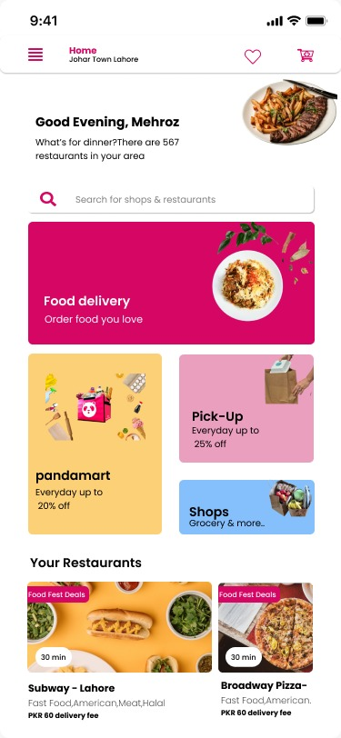
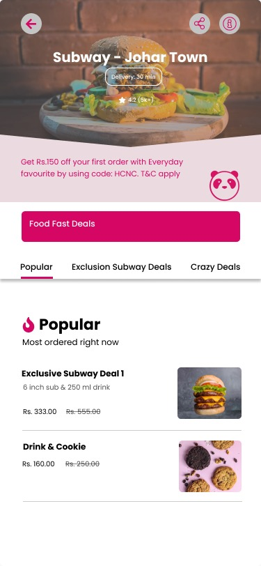
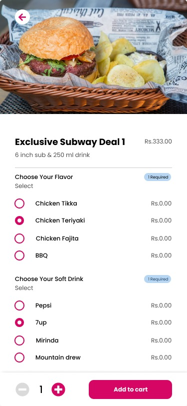
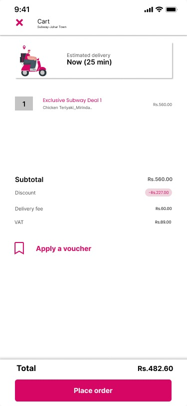

# Figma Setup & Canvas Exploration

## Steps Done
1. Signed up on figma.com (free plan).
2. Opened Figma Community and duplicated a **Foodpanda** mobile app design into my Drafts.
3. Explored the canvas:
   - **Layers panel (left):** list of all frames/screens
   - **Design panel (right):** size, colors, fonts, spacing
   - **Toolbar (bottom):** Frame, Rectangle, Pen, Text, Components
   - **Zoom / Pan:** Ctrl + scroll to zoom, Space + drag to move
   - **Export:** exported each frame as PNG (Shift + Ctrl + E)
4. Studied the 5 screens (Splash, Home, Restaurant, Item Details, Cart) to find usability problems.

## Figma Link
https://www.figma.com/design/ubBxMUhuy3XYtEHMaYrgUx/Foodpanda--Community-?node-id=3-5&t=HHplywHKT50kAKA2-0

## Screens in the File
| Splash | Home | Restaurant | Item Details | Cart |
|---|---|---|---|---|
|  |  |  |  |  |
