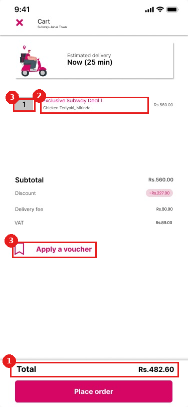
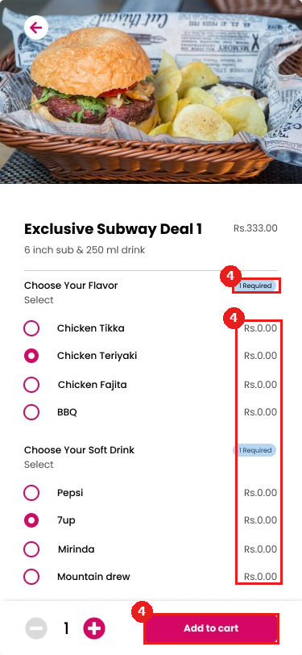
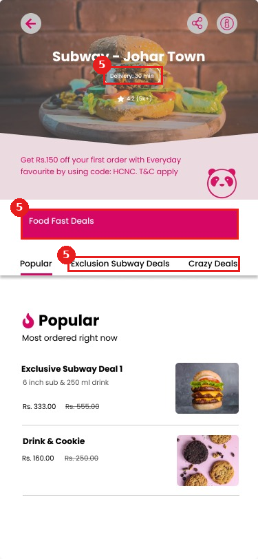
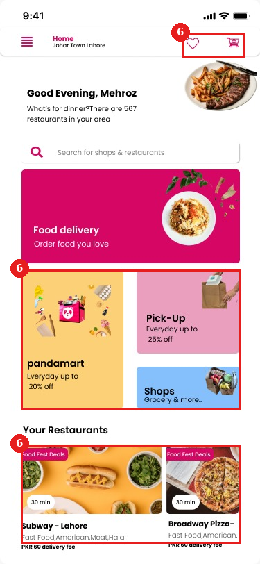

# Usability Evaluation: Foodpanda Mobile App

**Source:** Foodpanda mobile app design (Figma Community)
**Method:** Heuristic evaluation using Nielsen's 10 Usability Heuristics
**Task flow tested:** Open app → Browse restaurants → Open restaurant → Choose item → Add to cart → Place order
**Severity scale:** 1 = Cosmetic, 2 = Minor, 3 = Major, 4 = Critical

## Findings

| # | Screen | Problem | Heuristic Violated | Severity | Suggested Fix |
|---|--------|---------|--------------------|----------|---------------|
| 1 | Cart | Price does not add up: item shows Rs.560 (but Rs.333 on the details screen), and Rs.560 - 227 + 60 + 89 = Rs.482, yet the total shows Rs.482.60 | Visibility of system status | 4 | Show one consistent price everywhere and an exact, correct total |
| 2 | Cart | Drink selected on the details screen is 7up, but the cart shows "Mirinda"; text also has a double comma and is cut off ("Chicken Teriyaki,,Mirinda..") | Consistency and standards | 3 | Show the exact selections in the cart, and let the user see full text |
| 3 | Cart | Quantity box looks static, no clear way to edit or remove the item; voucher uses a bookmark icon | User control and freedom | 3 | Add +/- and delete buttons, use a voucher/ticket icon |
| 4 | Item Details | "Rs.0.00" repeated beside every option, tiny "1 Required" badge, and the Add to cart button does not show the updated price | Aesthetic and minimalist design | 2 | Show prices only when an option costs extra, make "Required" clearer, show total on the button |
| 5 | Restaurant | Inconsistent text: "Food Fast Deals" here vs "Food Fest Deals" on Home; tab says "Exclusion Subway Deals"; tiny low-contrast delivery time over the image | Consistency and standards | 2 | Fix spelling and naming, increase text size and contrast |
| 6 | Home | Many different colored tiles, cut-off text ("Broadway Pizza-", "Grocery & more..") and icons without labels (heart, cart) | Aesthetic and minimalist design / Recognition rather than recall | 3 | Fewer tiles, consistent colors, full text, add icon labels |

## Screenshots (problems marked in red)
| Problems | Screenshot |
|---|---|
| 1, 2, 3 (Cart) |  |
| 4 (Item Details) |  |
| 5 (Restaurant) |  |
| 6 (Home) |  |

Original screens are in `../screenshots/`. Fixes are shown in `../wireframes/`.

## Conclusion
Foodpanda has a clear ordering flow, but price inconsistencies, mismatched selections, limited cart controls, and a cluttered Home screen reduce trust and ease of use. These findings will guide the redesign of my own food delivery app, **TastyBite**, in the coming weeks.
