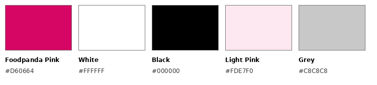

# UI Design Notes (Week 1)

Observations from the Foodpanda screens, to reuse as lessons for my own app (**TastyBite**).

## Color Palette

| Color | Hex | Used for |
|---|---|---|
| Foodpanda Pink | #D60664 | Buttons, headings, brand color |
| White | #FFFFFF | Background |
| Black | #000000 | Main text |
| Light Pink | #FDE7F0 | Offer banners, highlights |
| Grey | #C8C8C8 | Disabled buttons, placeholders |

## Typography
- Clean sans-serif font (Poppins-style)
- Bold for titles and prices, regular for descriptions

## Screen Flow
Splash → Home → Restaurant → Item Details → Cart → Place order

## What Works Well
- One strong brand color makes buttons easy to spot
- Big primary button at the bottom (Add to cart / Place order)
- Clear food photos
- Short, simple flow with few steps

## What to Improve (lessons for TastyBite)
| Lesson | Why |
|---|---|
| Keep prices consistent on every screen | Builds trust |
| Show exact selections in the cart | Avoids order mistakes |
| Add labels to icons | Easier to understand |
| Use larger text and higher contrast | Easier to read |
| Reduce colorful tiles on Home | Less clutter |
| Show total price on the action button | Clear next step |
