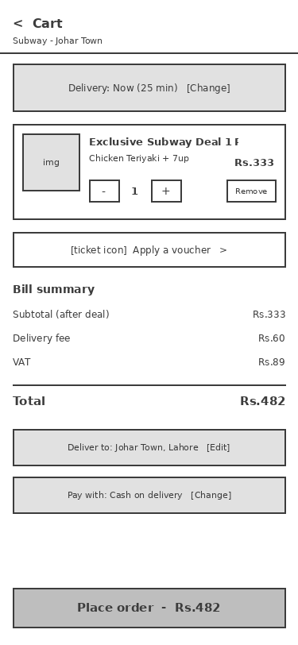
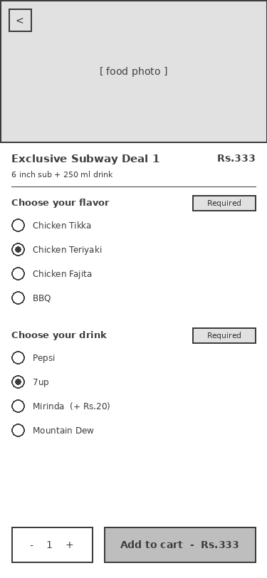

# Wireframes (Week 1)

Low-fidelity wireframes that fix the usability problems found in the Foodpanda evaluation (see `../research/foodpanda-usability-evaluation.md`).

## 1. Improved Cart

| Problem fixed | Change in wireframe |
|---|---|
| #1 Price does not add up | One price everywhere; Subtotal + Delivery + VAT = Total (333 + 60 + 89 = 482) |
| #2 Selection mismatch | Cart shows exact choices: "Chicken Teriyaki + 7up" |
| #3 No edit/remove | Clear **- 1 +** buttons and a **Remove** button; ticket icon for voucher |
| Extra | Delivery address and payment method visible before Place order |

## 2. Improved Item Details

| Problem fixed | Change in wireframe |
|---|---|
| #4 "Rs.0.00" repeated | Price shown only for options that cost extra (Mirinda + Rs.20) |
| #4 Tiny "Required" badge | Larger "Required" label beside each group |
| #4 Button without price | Button shows total: **Add to cart - Rs.333** |

## Tool
Drawn as grayscale boxes to focus on layout, not colors. High-fidelity versions will be made in Figma in the next weeks (TastyBite).
